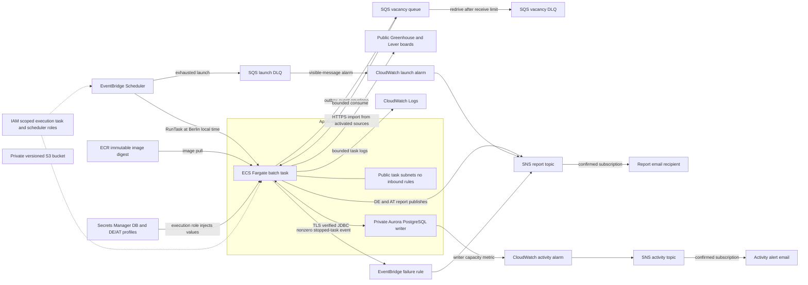

# Phase 5 AWS architecture and batch data flow

This is a public-safe view of the Terraform configuration and the bounded application path. It describes owner-reported deployment evidence through 2026-11-09, not a live AWS inventory. The recurring Tuesday/Thursday 19:00 `Europe/Berlin` schedule is enabled in AWS. The first recurring launch failed at Scheduler IAM on 2026-11-10. After that was fixed, a controlled task launched but failed during database startup; no successful recurring run has been observed.

The task receives a temporary public IP in a public subnet and has no inbound security-group rule. Outbound HTTPS reaches approved public sources and AWS APIs; port 5432 reaches only the private database security group. There is no NAT Gateway, load balancer, always-on ECS service or public Aurora endpoint. The private S3 bucket is encrypted, versioned and blocked from public access, but **the scheduled batch does not currently store vacancy data or reports in S3**. Terraform also retains separate one-off migrator and restricted application task definitions; migrations use a dedicated database role, while the scheduled task uses the restricted application role. The application image is selected by digest from ECR. An ECS execution role pulls it, writes task logs and injects the database password and private profile JSON from Secrets Manager; the task role is scoped to the vacancy queue and report SNS topic. The profile contents, recipient address and secret values are outside Git.

## One scheduled invocation

1. Scheduler targets one Fargate task with `--mode=scheduled-batch`; its configured timezone follows Berlin daylight-saving changes. The Java process uses the Berlin calendar date as the durable invocation key. A duplicate launch for a completed date does no new processing or report publication. Active or ambiguous work requires operator review.
2. The task imports active, previously verified source boards once. Source snapshots, normalized vacancies and pending outbox events are persisted in PostgreSQL with stable source identity and transactional boundaries. The stored original URL, source payload, observation time and version preserve provenance. The outbox publisher sends identifier-only envelopes to the standard SQS vacancy queue after commit. A confirmed send marks the outbox event `PUBLISHED`, meaning transport acceptance, not evaluation completion.
3. The task consumes the queue once under the DE profile. The versioned consumer validates event identity and revision; a superseded event is recorded as stale instead of evaluating the latest vacancy under an older event. Its receipt, evaluation and event-effect link commit together. SQS deletion follows commit. A lost delete can cause redelivery, but the receipt prevents another committed effect. The queue is at-least-once and may reorder or duplicate messages.
4. Both private profiles then independently sweep current stored vacancies under `rules-v1`, including vacancies already in the database when SQS has no pending event. This registers both profile identities and produces current profile-specific evaluations without a second import, second queue pass or fabricated SQS receipt. Unknown work-country permission or salary remains unknown. Each report selects its own relevant shortlist, capped at 20 entries, from current persisted evaluations and trusted live-source identities; synthetic fixtures remain available for diagnostics but are not user-facing report entries.
5. PostgreSQL holds one invocation and separate DE/AT report rows for each Berlin date. Each row progresses through `RUNNING`, `PREPARED`, `PUBLISHING` and `PUBLISHED`, or records `FAILED`/`UNCERTAIN`. Report text is prepared before the SNS call. SNS publishing is outside the database transaction. A confirmed DE publication is not sent again if AT later fails. The report email is plain text and bounded to 10,000 UTF-8 bytes. SNS acceptance does not prove inbox delivery or content quality.

The existing Google Sheet remains the master of the **old** pipeline until a verified cutover. This batch does not migrate Gmail/Sheets state, submit applications, send CVs or make automatic paid LLM/search calls.

## Failure and operator checks

Scheduler has one launch retry within a five-minute event age and a dedicated 14-day launch DLQ. A CloudWatch alarm watches visible launch-DLQ messages. A separate EventBridge rule sends a report-topic alert when a scheduled-group task stops with a nonzero or missing container exit code. The task has a bounded process watchdog; an abrupt stop may leave committed import/outbox work and an active invocation. A failure alert is a signal to inspect the ECS task exit code and CloudWatch log stream, the Berlin-date invocation and both profile report states, the outbox backlog, SQS source queue and both DLQs before any retry. An alert does not itself roll back a committed database effect.

Outbox sends and SQS receives can repeat. Database claim fencing, unique identities, receipts and evaluation versions prevent repeated committed effects under their documented contracts. An invalid or repeatedly rejected vacancy message can reach the vacancy DLQ after the configured receive limit; inspect its envelope and persisted event before controlled redrive. A report row left `PUBLISHING` or marked `UNCERTAIN` may represent an SNS request accepted without a final database acknowledgement. **Do not automatically resend it.** Reconcile the SNS result and delivery evidence before an explicit recovery decision. A `PUBLISHED` row for one country must not be replayed because the other country's report failed. Missing telemetry, delayed events, unconfirmed subscriptions and email filtering can hide or delay alerts.

## Evidence and remaining verification

The owner reported one controlled two-profile task on 2026-11-08: exit 0, separate DE and AT `PUBLISHED` markers, both emails received and two subsequent writer-capacity periods at 0 ACU. Earlier bounded AWS checks covered migration and restricted database access, one diagnostic SQS delivery/duplicate/DLQ smoke, one rules evaluation with a synthetic profile, and an isolated Aurora point-in-time restore against a largely empty reference. The 2026-11-08 Germany email exposed unrelated and synthetic entries plus technical codes; successful delivery was not content acceptance.

The replacement image is deployed and its ECR basic scan reported zero findings. A controlled invalid-argument ECS task exited 1, delivered a failure email, left no running task and was followed by Aurora at 0 ACU. The clearer report content is **not yet verified in AWS**. A successful recurring run, revised report content, sustained reliability and a full populated-data recovery remain unverified. The ECR basic scan is not a complete application dependency audit.

## Cost and controls

Fargate CPU/memory and temporary public IPv4 accrue while tasks run. Aurora compute depends on ACU and wake/activity time; storage, I/O and retained backups can cost money while the writer is paused. Secrets Manager, S3 versions, ECR images, CloudWatch logs/alarms, SNS delivery and SQS requests add usage. The prior [Phase 5 estimate](PHASE_5_TASK.md#monthly-cost-sketch-us-east-1-before-credits) covers only an initial foundation. The [scheduled-run sketch](PHASE_5_SQS_RUNBOOK.md#scheduled-reports-and-controlled-aws-run) assumes about 8–9 starts per month and a bounded task duration; it is not a measured bill or a complete Phase 5 total. Two observed 0-ACU periods after one run show a return to idle, not a guarantee that every future run pauses or costs the same.

The task's bounded runtime, 0–2 ACU configuration with a 300-second auto-pause setting, one-day automated-backup retention, immutable image tags, 14-day task-log retention, activity alarm and account budget emails are controls or warnings, **not hard spending caps**. The writer activity alarm looks for approximately one hour of sustained nonzero capacity; it does not prove why the database is active or stop it. Review account billing and credits separately from these estimates.

Implementation details: [Phase 5 task](PHASE_5_TASK.md), [SQS and scheduled-run runbook](PHASE_5_SQS_RUNBOOK.md), [cloud foundation ADR](adr/0008-terraform-cloud-foundation.md), and [SQS delivery ADR](adr/0009-sqs-outbox-delivery.md).
