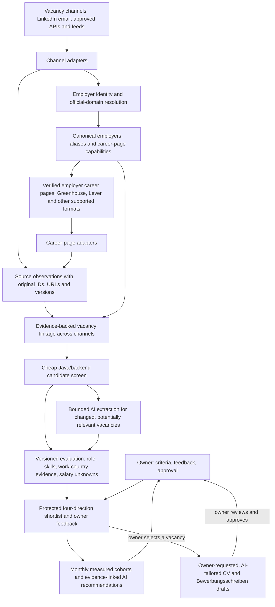
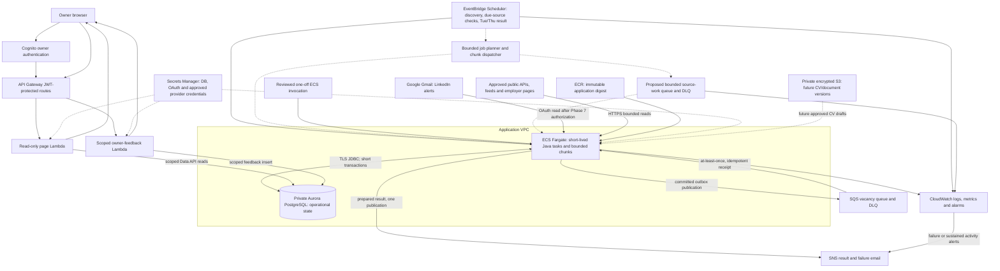

# Target Job Agent architecture

Status: owner-agreed direction recorded 2026-11-17; **target design, not deployed inventory**. [The master plan](../MASTER_PLAN.md) defines delivery order. [The Phase 5 architecture](PHASE_5_AWS_ARCHITECTURE.md) records the narrower deployed AWS batch. [The retirement register](SOURCE_ARCHITECTURE_RETIREMENT_REGISTER.md) tracks code paths to replace and remove. Historical Phase 0 and Phase 3 decisions remain dated evidence, not current source-coverage requirements.

## 1. System and data-flow diagram

The channel-to-observation path does **not** depend on finding a career page. An employer can have a verified identity but no readable page, and an aggregator or email vacancy still enters screening and review. Conversely, a verified career page may supply vacancies absent from aggregators. Source observations remain distinct even when evidence links them to one canonical vacancy. Uncertain employer or vacancy matches stay separate for review; a name or AI assertion is not an identity proof.

The initial search directions are Germany, Austria, Remote Europe and Remote Worldwide. They are overlapping views of one vacancy corpus, not separate copies. A remote label does not establish permanent employment eligibility from the owner's private work country. Missing or contradictory evidence is displayed as unknown. The role screen accepts generic backend/software-engineer titles when the description establishes relevant Java/Spring work; it does not require Java in the title.

Channel candidates for measurement are LinkedIn job-alert email, Adzuna, Himalayas and Arbeitnow. LinkedIn is the **first implementation/cutover channel** because the existing owner pipeline already receives a substantial alert stream. The Java application still needs separate Gmail OAuth. Adzuna's trial calls do not authorize a paid recurring plan; Himalayas and Arbeitnow require yield, duplication, terms and operational checks before adoption. A channel may be replaced without losing its retained employer identities or vacancy provenance. Greenhouse and Lever remain career-page adapters, not the mandatory discovery funnel.

## 2. Target AWS infrastructure diagram

Solid relationships describe the intended logical role, **not evidence that every integration is deployed**. The existing infrastructure includes the Tuesday/Thursday EventBridge-to-Fargate batch, Aurora, ECR, Secrets Manager, CloudWatch, the vacancy SQS/DLQ, SNS, private S3 and the protected Cognito/API Gateway/Lambda page. Gmail OAuth, additional channel credentials, a due-source planner, a source-work queue, scaled chunks and CV access are proposed. The exact source-work dispatch mechanism must be chosen from measured throughput and cost before Terraform changes. There is no requirement for an always-on ECS service, NAT Gateway or public database endpoint.

## 3. Triggers and boundaries

| Trigger | Work and durable outcome | Failure boundary |
| --- | --- | --- |
| Phase 7 Gmail ingestion schedule or reviewed one-off | Read LinkedIn alert message IDs, parse bounded vacancy cards, commit source observations and pending effects. | Commit PostgreSQL before marking/labeling/archiving a Gmail message. A failed Gmail action retries without repeating domain effects. Until cutover, the existing Sheet is the sole master of the old pipeline. |
| Approved channel discovery schedule | Read only permitted APIs/feeds within provider-specific call and spend limits. Persist vacancies and employer leads independently. | One provider's failure does not discard committed observations from another or suppress already due evaluations. |
| Due-source schedule | Select career pages whose `next_check_at` is due; claim bounded chunks and fetch outside DB transactions. | Retry transient errors with backoff; retain the last valid snapshot and expose stale/unsupported status. No source is silently dropped. |
| New or changed observation | Commit source item, employer/vacancy linkage and outbox event together; publish an identifier-only SQS envelope after commit. | Stable IDs, revision checks and receipts handle at-least-once/reordered messages. Ambiguous cross-channel matches require review. |
| Evaluation work | Cheap role screen first; call an approved AI provider only for changed, potentially relevant content within explicit budget. Save evidence, unknowns, model/prompt/policy version and usage. | Unknown remote eligibility or salary is not promoted to confirmed. Provider failures remain retryable without hiding the original vacancy. |
| Existing Tuesday/Thursday result slot | Read current stored evaluations, prepare one combined result, publish through SNS and link to the page. | Preserve publication identity and review `PUBLISHING`/`UNCERTAIN`; do not automatically resend an ambiguous email. |
| Owner page request | Cognito/JWT and owner check, then read stored projections through a scoped Lambda. Feedback uses a distinct writer role and append-only history. | Opening the page does not crawl sources or call an LLM. A read failure does not change batch state. |
| Monthly analysis after sufficient data | Compute comparable cohorts and source-coverage changes, then ask AI for cited interpretation and proposed actions. | More connected employers must not be presented as proof that the whole job market grew. Insufficient samples produce no trend claim. |
| Owner chooses to apply | Use a confirmed base CV and approved private documents to draft a vacancy-tailored CV and Bewerbungsschreiben. | Show changes and evidence for owner approval; no CV, letter or application is sent without a separate explicit authorization. |

Initial source discovery and monitoring frequencies are **not yet chosen**. The existing result email stays Tuesday/Thursday at 19:00 Europe/Berlin until an approved schedule change. At scale, due-time scheduling and bounded chunks must demonstrate acceptable revisit time for hundreds or thousands of employers; the current five-source round-robin is insufficient. Separate provider budgets, Fargate duration, Aurora wake time and queue/log costs must be estimated before enabling new recurring work.

## 4. Data and trust contracts

- Canonical employer identity is separate from provider-local company IDs, display-name aliases, verified official domains and career-page capabilities. An employer may have no usable career page. Conflicting claims never merge by name alone.
- Source observations use provider-local IDs/URLs and preserve attribution, timestamps, content/version digests and allowed payloads. Cross-channel vacancy linkage is evidence-backed and reversible on review; counts use canonical vacancy IDs and report overlap.
- Provider listings may be visible and evaluated under their own provenance without pretending the employer page verified them. Preserve each provider's attribution, retention, application-link and expiry requirements.
- Four search-direction views use versioned private criteria and explicit work-country evidence. Remote Europe/Worldwide do not imply eligibility from every country. Owner decisions are personal feedback, not vacancy facts or automatic changes to criteria.
- HTTP and LLM calls occur outside DB transactions. Short transactions persist state and pending work. SSRF-safe destination checks, credentials, output limits, rate limits, provider terms and minimum IAM grants apply to new adapters.
- Historical Flyway migrations and already published results remain immutable. Add migrations and reconcile existing employer/vacancy references before cutover or changing page reads.

## 5. First delivery and later work

**Phase 7 is first:** bring LinkedIn job alerts from the existing Gmail/ChatGPT/Sheet pipeline into the Java application as a read-only, independently authorized intake; persist stable message/card IDs and provenance; reconcile against the old pipeline; then perform a controlled final delta and owner-approved master switch. Do not stop the old writer or let an isolated test copy trigger external actions before reconciliation. The first cloud proof must show a LinkedIn-only vacancy appearing on the protected page even when no career page is known. Phase 7 implementation must not depend on Adzuna, Himalayas, Arbeitnow or a new paid service.

**Phase 9A.1 then broadens coverage:** adopt additional measured channels, canonical employers, official career-page verification and due-time monitoring. Each channel needs an incremental-yield and terms/cost check. Replace obsolete Tavily/ATS-only orchestration according to the retirement register. **9A.2** provides the separate protected opportunity report after the source model can report both direct-channel and career-page provenance. **9B** computes comparable monthly market/skill/employer cohorts; **9C** asks AI for evidence-linked trend interpretation and actions without claiming causality. **Phase 10** stores approved base CV versions and drafts vacancy-tailored CVs and Bewerbungsschreiben; no autonomous submission. Phase 8 remains optional if measured semantic matching gains justify it.
